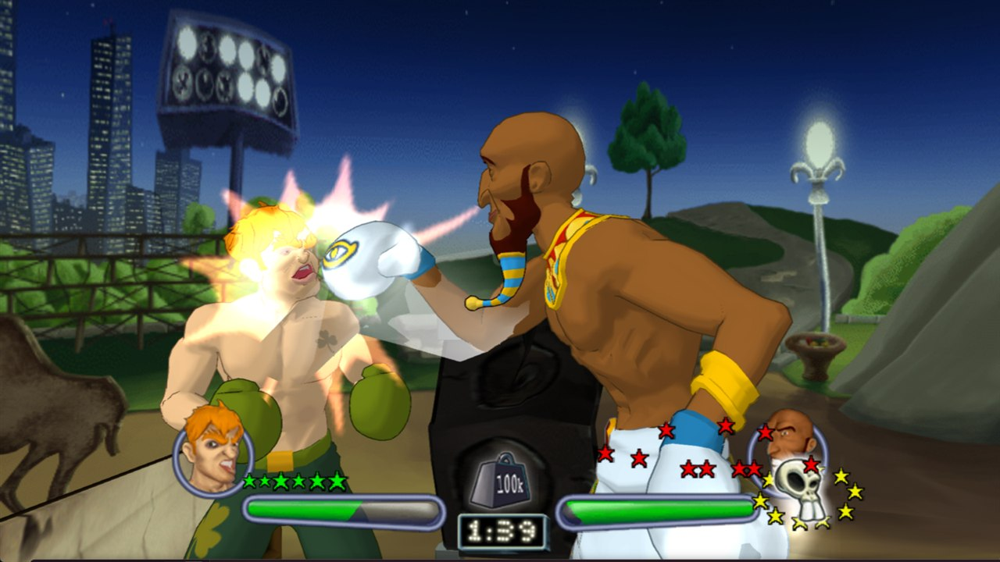
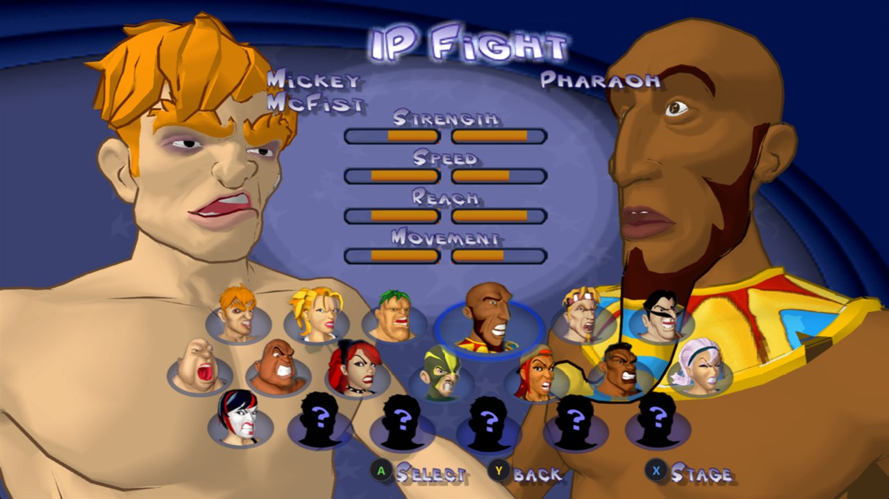
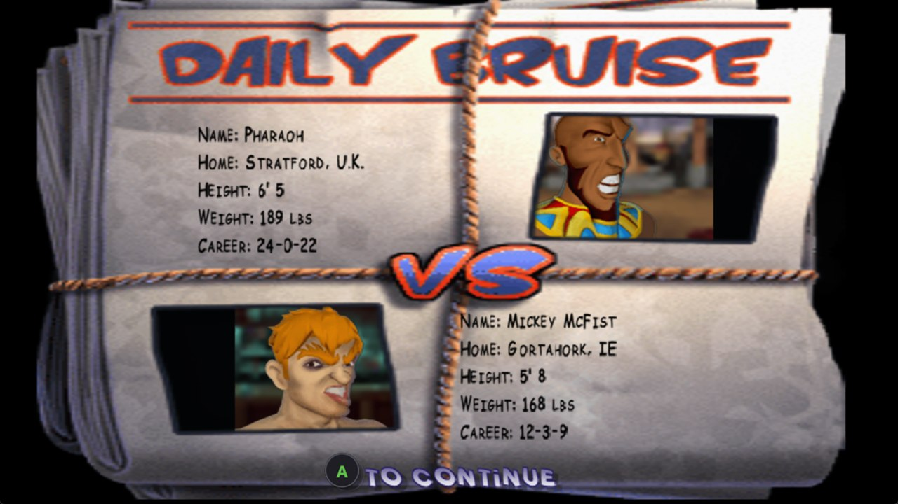
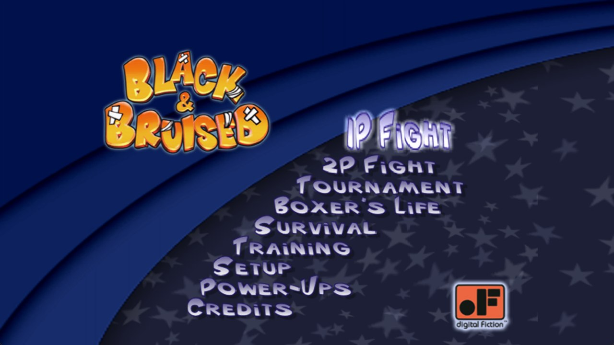
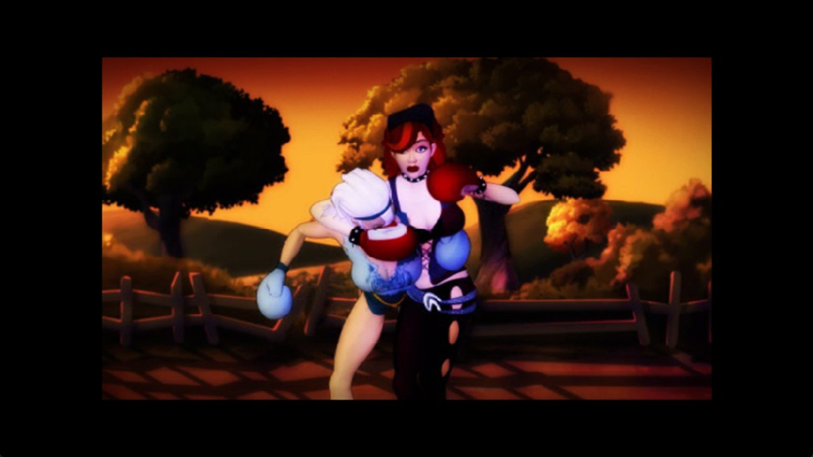
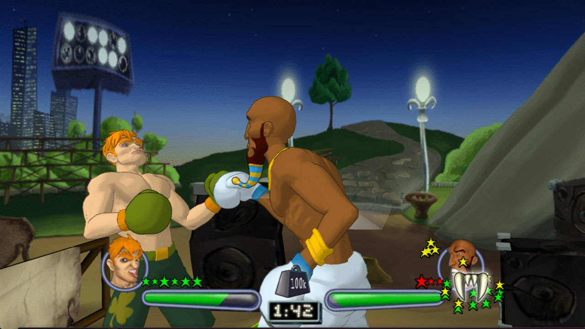
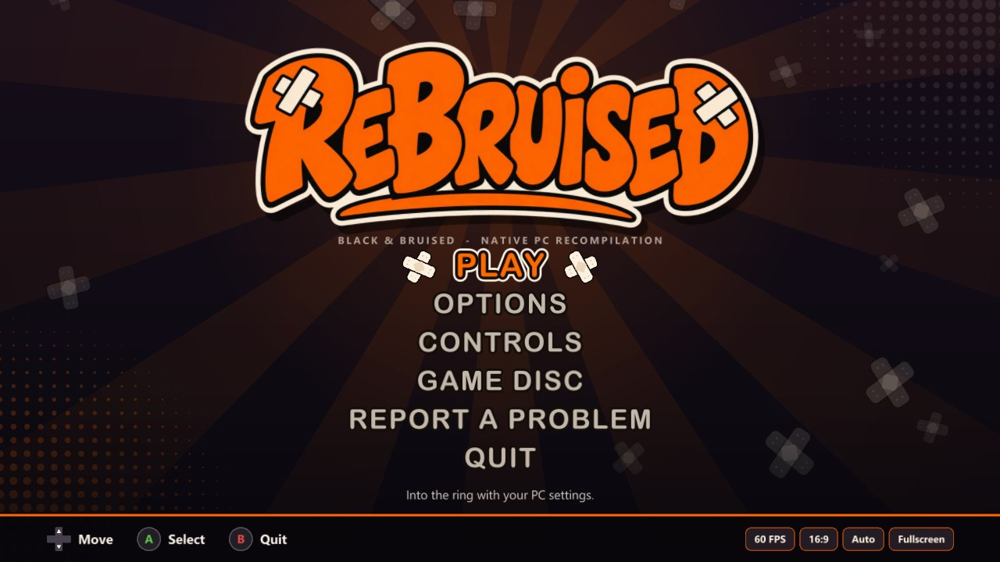

<p align="center">
  
</p>

<p align="center"><b>A native PC recompilation of Black & Bruised (PS2)</b></p>

**ReBruised** is a native PC version of **Black & Bruised** (PlayStation 2, 2003), the cartoon boxing game by
Digital Fiction. It isn't an emulator: the game's own code is statically recompiled into a Windows program, with
modern extras on top. Those extras are 60 fps, higher resolutions, widescreen, anti-aliasing and XInput controllers.

> **Status: 0.5.0, playable.** Menus, IP Fight and the movies work, and a few of the Boxer's Life fights have been
> played through. It's still early, so expect some bugs, and please [report them](../../issues).

> **No game files are included.** You need your own copy of the **PAL** release (**SLES-51620**) as an `.iso`
> disc image. The first time you press PLAY, ReBruised rebuilds the game from your disc on your own PC.

## Screenshots

<p align="center">
  
</p>

<table>
  <tr>
    <td></td>
    <td></td>
  </tr>
  <tr>
    <td></td>
    <td></td>
  </tr>
  <tr>
    <td></td>
    <td></td>
  </tr>
</table>

<p align="center"><sub>Captured at 1600×900 with widescreen on.</sub></p>

## Requirements

- Windows 10 (version 1903 or newer) or Windows 11, 64-bit
- A CPU with SSE4.1 (almost any desktop or laptop CPU from the last 12+ years)
- A graphics card with OpenGL 3.3 and an up-to-date driver (NVIDIA, AMD or Intel)
- About 1 GB of free disk space (the download unpacks to ~600 MB; the build adds ~250 MB)
- Your own **Black & Bruised (Europe)** disc as an ISO image (SLES-51620)
- Optional: an XInput controller (Xbox-style). PlayStation and Nintendo pads work through Steam Input or DS4Windows.

## Getting started

1. Download `ReBruised-<version>.zip` from [Releases](../../releases) and **extract the whole zip** to a folder you can
   write to, for example `Documents\ReBruised` or `C:\Games\ReBruised`. Don't use `Program Files`, and don't run it from
   inside the zip.
2. Start `ReBruised.exe`.
3. **GAME DISC:** select your `.iso`. The launcher checks that it's the PAL disc and copies the game's program file and
   its sound modules (about 2.5 MB) to `%LOCALAPPDATA%\ReBruised\disc`. Everything else is read straight from your
   image.
4. **Building the game:** ReBruised now recompiles the game from your disc into `BlackAndBruised.exe`. This happens once
   (and again after an update) and takes a few minutes (up to 10 on slower or busy PCs). Nothing is downloaded.
5. Press **PLAY**.

Keep the ISO where it is: the game reads from it while you play. If you move it, select it again under GAME DISC.

## Controls

| PS2 | Controller (Xbox layout) | Keyboard |
|---|---|---|
| Cross | A | Down / X / Space |
| Circle | B | Right / C / Esc |
| Square | X | Left / Z |
| Triangle | Y | Up / V |
| L1 / R1 | LB / RB | Q / E |
| L2 / R2 | LT / RT | Left Shift / Right Shift |
| Start / Select | Start / Back | Enter / Tab |
| Move | Left stick / D-pad | W A S D |

While playing: **F11** or **Alt+Enter** switches fullscreen, **F9** toggles widescreen and **F8** changes the HUD
filter.

## Options

Set them in the launcher's **OPTIONS** page (stored in `settings.ini` next to `ReBruised.exe`):

- **Frame rate:** 60 fps (the game's 60 Hz timing, like the NTSC release) or 50 fps (original PAL speed)
- **Display:** windowed, borderless or exclusive fullscreen
- **Resolution:** native (448 lines) up to 4K, or auto (fits your monitor)
- **Widescreen:** 16:9 with a wider view in fights, optionally for menus too
- **Anti-aliasing** (FXAA / SSAA), **anisotropic filtering**, **scaling** and the **HUD** filter

## If something goes wrong

- **REPORT A PROBLEM** in the launcher saves a zip of the relevant logs (`logs\`, `build-game\build.log`, your
  settings without folder names) to your Desktop. Attach it to an [issue](../../issues).
- **The build stopped:** the launcher shows why. Common causes: the folder isn't writable (move ReBruised out of
  Program Files), not enough disk space, or antivirus software blocking the compiler. Some antivirus programs scan
  or quarantine a freshly compiled program; allow `BlackAndBruised.exe` if that happens.
- **"Could not start OpenGL 3.3":** update your graphics driver. Remote Desktop sessions and the basic Microsoft
  display driver aren't supported.

## Known issues

See the release notes of each version. In short: with widescreen on, some boxers' arms are cut off at the screen
edges on the character select. Most of Boxer's Life, memory card saves, two-player matches and long sessions haven't
been tested much yet.

## How it works

ReBruised builds on [PS2Recomp](https://github.com/ran-j/PS2Recomp), a static recompiler that turns PS2 (MIPS R5900)
programs into C++, and its runtime. The runtime emulates the hardware around the game's code: graphics (GS, with an
OpenGL renderer), the vector units, the I/O processor with the game's own sound driver, the disc, and movies.

- `source/ps2recomp`: PS2Recomp with our fixes and additions (renderer, sound, timing, widescreen, input).
- `port/`: the Black & Bruised front end: `main.cpp`, the launcher, disc setup and button prompts.
- `config/`: the recompiler configuration for SLES-51620. It holds function addresses and names, but no code or data
  from the game.
- `tools/`: the build pipeline, the release packager (`make_release.py`) and the player-side build
  (`player_build.py`).

A release contains the runtime already compiled, the recompiler, a compiler (llvm-mingw) and Python, but no code or
data from the game. `tools/make_release.py` refuses to package anything derived from the disc: it compares every file
it built against the game's program and modules, and checks for recompiled function names.

### Building from source (developers)

You need your own disc extracted to `game\disc\` and the image at `game\BnB.iso`, and Python 3.12 at
`python\python.exe` (the full Windows embeddable package works). You also need
[llvm-mingw](https://github.com/mstorsjo/llvm-mingw) (clang 22) with CMake and Ninja on its path; set `BNB_TOOLCHAIN`
to it or link it as `llvm-mingw\` in the project root. Then run:

```
tools\build_host_tools.ps1        # the recompiler (ps2_recomp.exe) from source\ps2recomp
tools\build_program.ps1           # recompile + build build\program\bin\BlackAndBruised.exe and the launcher
python tools\make_release.py --version X.Y.Z   # package a release into dist\
```

## Legal

ReBruised is a fan project. It isn't affiliated with or endorsed by Digital Fiction, Majesco or Sony. Black & Bruised
is a trademark of its owners. This repository and its releases contain no part of the game. Play only with a copy you
own.

ReBruised is licensed under the **GNU General Public License v3.0** (see `LICENSE`), the licence of PS2Recomp, which
it includes. Third-party components keep their own licences. Their licence texts are in the release's `licenses\`
folder: raylib (zlib), Dear ImGui (MIT), FFmpeg (LGPL-3.0), llvm-mingw (Apache-2.0 with LLVM exception and others) and
Python (PSF).
